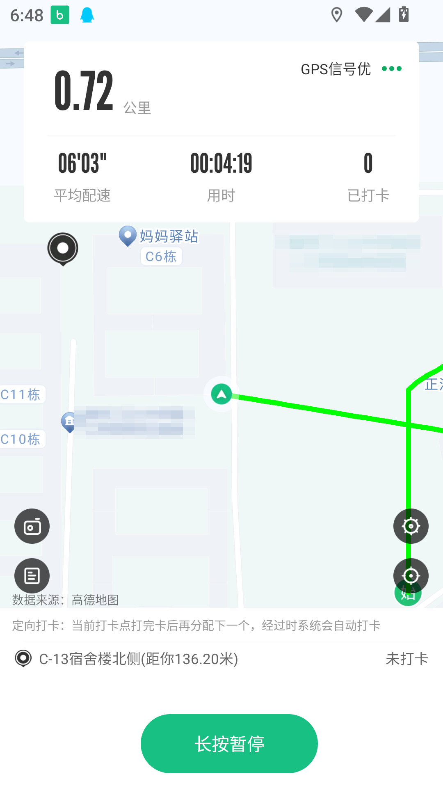
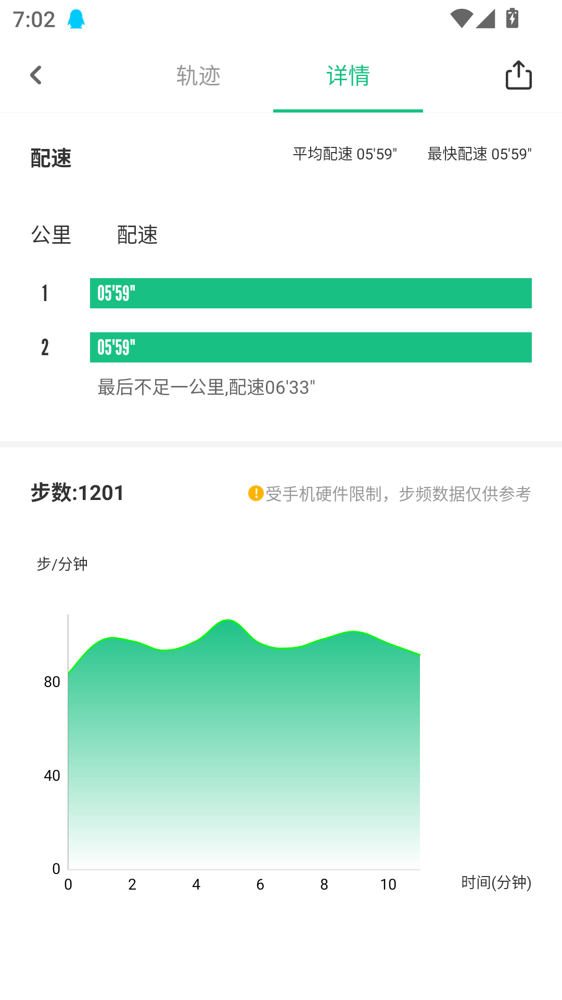
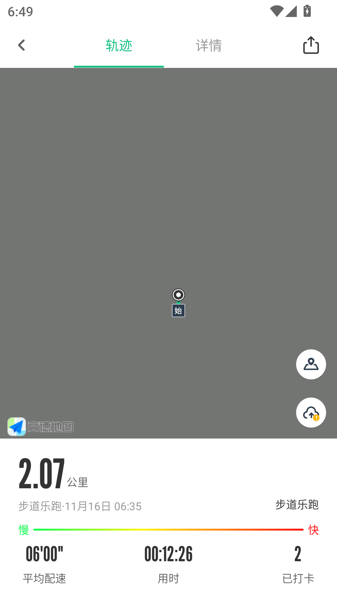

# 步道乐跑校园定向跑自动化闭环系统 (`budao-lepao`)

> **声明：本项目仅供 Python 自动化、计算机视觉（OCR）以及移动端控制技术的学习与学术研究交流，请勿用于任何商业用途或违规代跑！**

[](https://www.python.org/)
[](LICENSE)
[](https://github.com/RapidAI/RapidOCR)

---

## 💡 项目初衷

目前很多高校的体育打卡规定了严苛的**晨跑时段**（例如清晨 06:30 ~ 07:30）。  
然而，很多大学生的作息与课程安排导致**“早起实在起不来，但平时更习惯在下午或晚上跑步”**，却常常因为缺卡晨跑而影响学期体育成绩。

本项目正是**为了解决早上起不来、但想在晚上/课余时间自由锻炼的同学们的痛点**而诞生。通过基于 Android 模拟器的高精度虚拟定位、离线 OCR 屏幕状态识别与动态自适应梯度寻路算法，在本地电脑上实现合规、稳定且全自动的晨跑定向打卡闭环。

---

## 📸 运行效果截图

<div align="center">
  <table style="margin: 0 auto; text-align: center;">
    <tr>
      <td align="center"><b>跑步中实时监测与打卡</b></td>
      <td align="center"><b>最终配速与各项指标结算</b></td>
      <td align="center"><b>轨迹地图与两点打卡达标</b></td>
    </tr>
    <tr>
      <td></td>
      <td></td>
      <td></td>
    </tr>
  </table>
</div>

---

## ✨ 核心特性

1. **正交梯度自适应寻路（无需预录打卡点）**
   - 步道乐跑的打卡点是每隔 250m 随机动态分配的，系统无法提前预知下一个打卡点的绝对坐标。
   - 算法通过在当前位置施加微小正交探测位移，实时估算 App 显示的“距你 xx 米”的空间梯度负方向，沿负梯度直线逼近；
   - 距目标点 20 米内自动减速并停留等待系统打卡，打卡成功后立即启程前往下一目标。
2. **离线 RapidOCR 视觉状态闭环（告别崩溃卡死）**
   - 跑步页面计时器每秒都在高频刷新，原生 `uiautomator dump` 因等不到 UI 空闲会触发系统 `rc=137` 强退被杀；
   - 本项目通过 `exec-out screencap` + 离线轻量级 `RapidOCR` 局部区域截屏识别，毫秒级获取当前里程、用时与打卡点状态，且完全不阻塞 1Hz 定位下发。
3. **配速与步频严格闭环锁定**
   - 严格锁定学校规定的配速合格区间（默认目标配速 `6'00"/km`，瞬时速度锁在 `2.30 ~ 4.40 m/s`）；
   - 自动平衡由于打卡停留损失的时间，随后平滑加速补回，确保最终平均配速精准稳定达标。
   - 配合 MuMu 本地网关定时触发加速度计脉冲（摇一摇），同步注入真实步数与跑步动态步频。
4. **全自动容错与静默后台运行**
   - 启动前自动拉起并连接 MuMu 模拟器；
   - 自动跳过开屏广告，自动处理 App 弹出的“必要权限未开启”等提示弹窗（连续自动确认“暂不开启继续跑步”）；
   - 达标（2.05 km + 2 个打卡点）后自动长按屏幕结束按钮并确认保存，保存后自动输出运行结果。
5. **配套纯离线仿真器（`campus_run_sim.py`）**
   - 内置基于虚拟时钟与 Fake App 的纯离线仿真算法，不连模拟器也能在 0.5 秒内完整模拟 2.05 公里跑程与梯度寻路。

---

## 🛠️ 环境准备

### 1. 软件环境
* **操作系统**：Windows 10 / 11 64位
* **Python**：Python 3.10 及以上（推荐 3.12）
* **Android 模拟器**：[网易 MuMu 模拟器 12](https://mumu.163.com/)
  * 设备分辨率建议设为手机坚屏：`1080 x 1920`
  * Android 版本：推荐 Android 12
  * 模拟器系统设置中开启定位服务（高精度模式）

### 2. 安装 Python 依赖
```bash
pip install -r requirements.txt
```
*(主要依赖包括 `rapidocr_onnxruntime`, `onnxruntime`, `Pillow`, `numpy`, `opencv-python`)*

---

## 🚀 快速上手

### 1. 一键启动
确保 MuMu 模拟器已打开且已登录步道乐跑，在项目根目录下双击运行：
```bat
start_campus_run.bat
```
或通过命令行自定义参数运行：
```bash
python campus_run.py --pace 6.0 --km 2.05 --cps 2 --auto-start --auto-finish
```

### 命令行参数说明：
| 参数 | 类型 | 默认值 | 说明 |
| :--- | :--- | :--- | :--- |
| `--pace` | float | `6.0` | 目标平均配速（单位：分钟/公里），如 `6.0` 即 `6'00"/km` |
| `--km` | float | `2.05` | 目标总跑步里程（单位：公里） |
| `--cps` | int | `2` | 需要完成的随机打卡点数量（通常为 2 个） |
| `--auto-start` | flag | 启用 | 若 App 处于首页，自动点击“开始乐跑”并处理弹窗 |
| `--auto-finish` | flag | 启用 | 达到里程与打卡目标后，自动长按结束跑步并确认保存成绩 |

### 2. 离线算法验证（无须模拟器）
测试算法与逻辑闭环是否正常：
```bash
python campus_run_sim.py
```

---

## 📂 目录结构说明

```
budao-lepao/
├── README.md               # 项目使用说明文档与免责声明
├── LICENSE                 # MIT 开源许可证
├── requirements.txt        # 依赖包清单
├── .gitignore              # Git 忽略规则（严格排除个人隐私与超大安装包）
├── campus_run.py           # 核心主入口：梯度寻路导航与配速闭环控制
├── screen_state.py         # 状态识别模块：基于 RapidOCR 的离线截屏解析
├── campus_state.py         # 数据模型：RunState 结构体与解析辅助
├── campus_run_sim.py       # 离线算法仿真：虚拟时钟与 Fake App
├── start_campus_run.bat    # Windows 快速启动脚本
├── run_afternoon_once.bat  # 自动化任务调用批处理
├── start_assistant.py      # 辅助工具启动入口
├── assets/                 # 文档说明插图与截图
├── lepao/                  # 底层通信与仿真驱动模块
│   ├── __init__.py
│   ├── geo.py              # WGS84 / GCJ02 / BD09 坐标转换与球面测距
│   ├── mumu.py             # MuMu 网关通信、虚拟定位下发与窗口管理
│   ├── sensors.py          # 摇一摇传感器震动与步频计算
│   ├── routes.py           # 操场跑道算法
│   ├── track.py            # 轨迹记录模型
│   └── autolink.py         # 拓扑连通
└── tools/                  # 开发与单点调试工具
    ├── punch_gate.py       # 校门打卡调试
    ├── punch_cp2.py        # 目标点直达调试
    ├── run_trigger_cp2.py  # 第 2 打卡点触发调试
    ├── run_to_checkpoint.py# 单点寻径测试
    ├── run_300m_test.py    # 短程 300 米测试
    └── run_freerun_2km.py  # 自由跑测试
```

---

## ⚖️ 免责声明 (Disclaimer)

1. 本项目仅供学习、计算机视觉研究以及软件自动化测试技术交流使用。
2. 开发者不对使用本项目所产生的任何后果负责（包括但不限于账号异常、成绩未计入、违规处罚等）。
3. 请合理安排体育锻炼时间，强身健体是大学生活的关键部分，建议在课余时间走出宿舍、多进行真实的户外运动。
4. 如有侵犯相关方合法权益，请联系开发者进行删除或调整。
