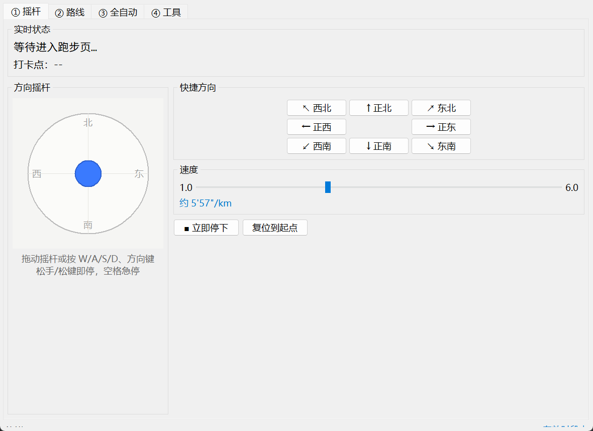
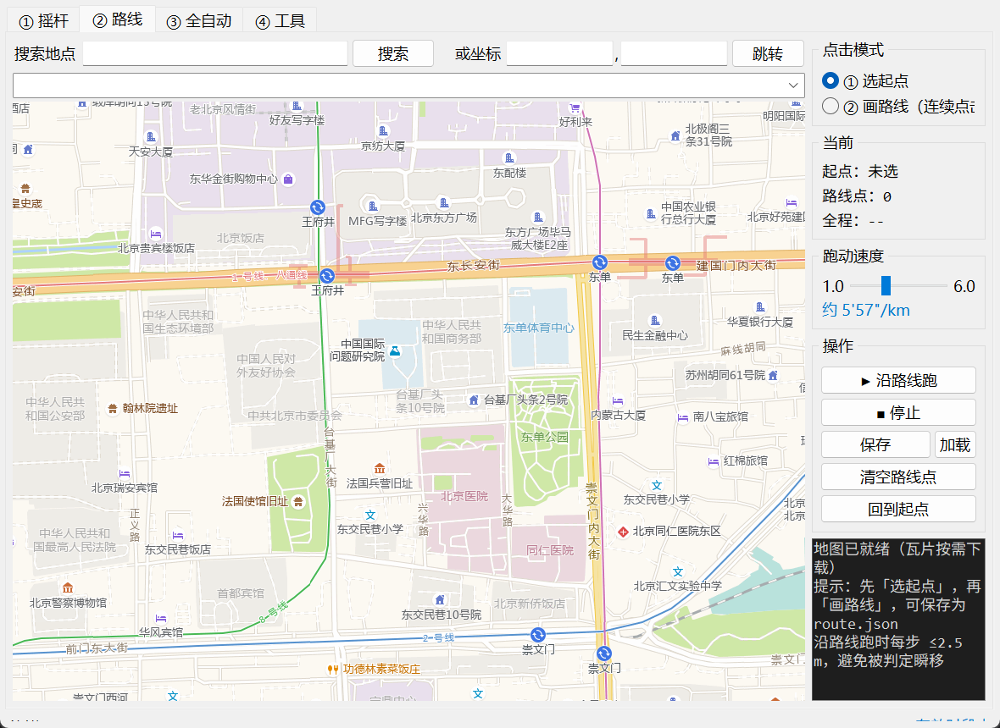
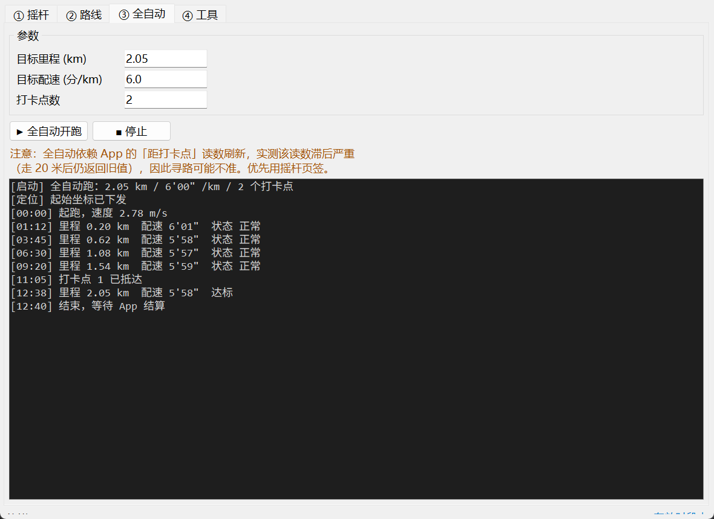
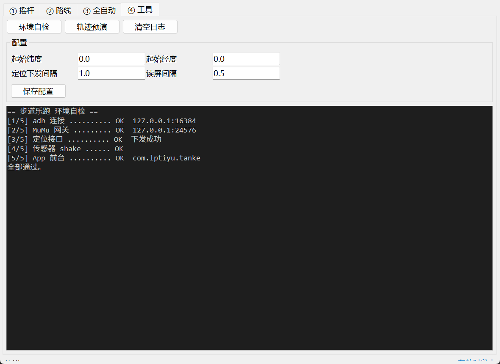

# 步道乐跑 一体化控制台

> 面向 MuMu 模拟器的步道乐跑辅助工具：**地图选点画路线 + 手动摇杆 + 全自动寻路** 三合一。
>
> 基于 [wmuj/budao-lepao](https://github.com/wmuj/budao-lepao) 重构，主要解决了原版**只服务单一学校、无法自定义路线、缺少 GUI** 三个问题。

---

## 先看几张图

| ① 摇杆手动 | ② 地图选点画路线 |
|---|---|
|  |  |

| ③ 全自动寻路 | ④ 工具与配置 |
|---|---|
|  |  |

> 截图中的坐标是占位示例，与任何具体学校无关。首次使用请在「② 路线」页搜索自己的学校，或直接在地图上点起点。

---

## 前置：脱壳版步道乐跑

原版 App 带加固（爱加密），在模拟器里会 `SIGSEGV in libdexfile.so` 直接闪退，**必须换脱壳版**：

**<https://github.com/guiheng123/budaolepao>**

装好脱壳版（本项目实测 4.3.3）再往下走。为什么必须脱壳、以及装完还要做什么，见 [关键的坑](#关键的坑二次开发必读) 第一节。

---

## 目录

- [先看几张图](#先看几张图)
- [前置：脱壳版步道乐跑](#前置脱壳版步道乐跑)
- [它解决什么问题](#它解决什么问题)
- [核心特性](#核心特性)
- [快速开始](#快速开始)
- [四个页签怎么用](#四个页签怎么用)
- [技术原理](#技术原理)
- [目录结构](#目录结构)
- [关键的坑（二次开发必读）](#关键的坑二次开发必读)
- [已知限制](#已知限制)
- [免责声明](#免责声明)

---

## 它解决什么问题

步道乐跑的校园跑有里程门槛、配速区间、打卡点等要求。在模拟器里跑，会碰到四个硬骨头：

| 问题 | 现象 | 本项目怎么做 |
|---|---|---|
| **定位注入** | 模拟器 GPS 是假的，怎么让它按路线走 | 走 MuMu 本地网关 HTTP 接口，逐段下发 WGS-84 坐标 |
| **反作弊** | 轨迹是直线 / 一步跳几十米 → 立即终止 | 增量推进（每步 ≤2.5 m）+ 转向抖动 + 禁止瞬移 |
| **步数** | 只推定位，App 记 0 步 | 按步频向网关发 `shake` 脉冲（84 spm） |
| **通用性** | 原版把作者学校的坐标写死在代码里 | 地图选点 + 路线绘制，配置外置到 JSON |

原版的核心算法（梯度寻路、配速闭环、OCR 状态机）保留并修复，外围补齐了 GUI 和可配置能力。

---

## 核心特性

### ① 摇杆手动控制

人眼直接看模拟器地图判断方向，脚本只负责按方向推进定位 —— 完全绕开「App 距离读数滞后」这个死结。

- 圆形摇杆拖拽 / `WASD` / 方向键 / `QEZC` 斜向 / 八方向快捷按钮
- 速度 1.0~6.0 m/s，实时显示对应配速
- 空格急停，松开方向键、离开摇杆页或窗口失焦时停止手动移动

### ② 地图选点 + 路线绘制

- **地名搜索**：内置 OSM Nominatim，输入学校名或地名直接跳转（返回 WGS-84，无需转换）
- **坐标跳转**：直接填经纬度
- **点击画线**：地图上点起点 → 连续点拐角 → 自动算全程距离
- **路线持久化**：存成 `route.json`，下次一键加载
- **沿路线跑**：按设定速度在线段上插值推进，每步 ≤2.5 m

支持 **z=3~18** 瓦片层级（z=3 可见全国，z=18 可见单栋楼）。

### ③ 全自动寻路

调用 `campus_run.py`：OCR 读屏 → 探测打卡点方位 → 梯度导航 → 配速闭环 → 自动结算。

> ⚠️ **当前不稳定**。自动寻路依赖 App 屏幕上「距打卡点 N 米」的数值，实测该数值刷新严重滞后（走 20 米后仍返回旧值），导致方向判断失准。**推荐优先使用摇杆或路线模式。**

### ④ 工具

环境自检（查询连接、应用信息并读取截图）、轨迹预演（离线生成轨迹图）、配置管理。

---

## 快速开始

### 环境要求

| 项 | 版本 |
|---|---|
| Windows | 10 / 11 |
| Python | 3.10+（开发环境 3.12.16） |
| MuMu 模拟器 | 12，Android 12，实例 #0 |
| 步道乐跑 | **脱壳重打包版**（官方版有加固壳，在模拟器里会 SIGSEGV） |

### 安装

```bat
cd budao-lepao
python -m venv .venv
.venv\Scripts\pip install -r requirements.txt
```

依赖：`rapidocr_onnxruntime`（离线 OCR）、`onnxruntime`、`Pillow`、`numpy`、`opencv-python`。地图瓦片下载与 GUI 只用标准库。

### 运行

```bat
控制台.bat
```

或

```bat
.venv\Scripts\python.exe app.py
```

> `控制台.bat` 用 `pythonw.exe` 启动（不弹黑窗）。注意 `pythonw` 下 `sys.stdout` 为 `None`，代码里已做保护。

### 前置检查

启动前确认：

1. MuMu 已启动，实例 #0 已进入 Android 桌面
2. 步道乐跑已登录，并进入**跑步页**（能看到「长按暂停」）
3. MuMu 设置里 **ADB 调试已开启**

在 ④ 工具页签点「环境自检」查看连接和读屏状态。自检只查询，不会改动模拟器位置或传感器。若 ADB 尚未连接，可点控制台左下角状态栏重连。

---

## 四个页签怎么用

### ① 摇杆


```
实时状态  1.24 km  07:27  配速 06'04"  已打卡 1
          打卡点：体育馆门口   距 327 米

方向摇杆          快捷方向
   ↑北            西北 正北 东北
 西●东            正西      正东
   ↓南            西南 正南 东南

速度  1.0 ──●── 6.0    约 5'57"/km
      ■ 立即停下   复位到起点
```

看模拟器地图判断打卡点方位 → 推摇杆 → 顶部距离数字在减小说明走对了 → 距离接近 0 时停下等自动打卡。

### ② 路线


```
搜索地点 [你的学校名______] [搜索]   或坐标 [39.904200],[116.407400] [跳转]
[ 找到 2 个结果，选一个跳转                                  ▼ ]
┌─────────────────────────────────┬─────────────────┐
│                                 │ 点击模式         │
│           地  图                │  ○ 选起点        │
│                                 │  ○ 画路线        │
│                                 │ 当前：起点/点数/全程│
│                                 │ 速度 / 操作       │
└─────────────────────────────────┴─────────────────┘
```

**首次配置流程**：搜索学校 → 跳转 → 「选起点」点操场起跑位置 → 「画路线」依次点跑道拐角（两个直道端点 + 两个弯道顶点）→ 保存 → 之后直接「加载路线」+「沿路线跑」。

### ③ 全自动


填里程/配速/打卡数 → 点「全自动开跑」。参数通过命令行传给 `campus_run.py`。

> 全自动依赖 App 的「距打卡点」读数，而该读数刷新很慢（走 20 米后仍返回旧值），所以寻路可能不准。**优先用摇杆页**。

### ④ 工具


环境自检 / 轨迹预演 / 编辑起始坐标、定位下发间隔和读屏间隔。保存位置后，摇杆页的「复位到起点」会使用新坐标。

---

## 技术原理

### 定位注入

MuMu 提供本地 HTTP 网关（默认 `127.0.0.1:24576`）：

```http
POST /player/window
{"id": "<uuid>", "action": "location", "params": {"lat": .., "lon": ..}}
```

**注意坐标系**：定位层接收 **WGS-84**，内部转 BD-09 后下发（MuMu 按 BD-09 解释，再做 BD09→GCJ02→WGS84）。

支持的 action 实测清单：

| action | 结果 |
|---|---|
| `location` | ✅ 定位下发 |
| `tool_click` (`type: shake`) | ✅ 但只摇窗口，**不产生传感器数据** |
| `gravity` (`x/y/z`) | ✅ 接口成功，但**不改变加速度计读数** |
| `sensor` / `set_gravity` / `gyro` / `input` | ❌ `API_ACTION_NOT_SUPPORTED` |

### 反作弊规避

三条硬约束，每条都是实测撞出来的：

```python
STEP_MAX_M = 8.0            # 单段导航位移上限
step_size  = 2.5            # 巡航每步位移
# 巡航：从当前位置增量推进，绝不直接 set 绝对坐标
mv_n = dn - cur_n
mv_e = de - cur_e
```

| 违规行为 | 后果 |
|---|---|
| 一步跳 60 米 | 立即终止「跑步行为异常」 |
| 每步直接 set 绝对目标坐标 | 里程跳跃式增长，配速瞬间失真（实测 6 秒记 50 米 → 配速 2'00"）|
| 探测后瞬移回原点 | 立即终止（20 米瞬移） |

**轨迹自然化**：航向每秒抖 ±4°、速度抖 ±5%、位置抖 ±0.4 m —— 避免出现完美几何这种机器特征。

### 步频脉冲

```python
class StepFeeder(threading.Thread):
    MIN_SHAKE_INTERVAL_S = 0.70   # 单次 shake 处理耗时约 655ms
    MAX_CADENCE = 84              # 等效 84 spm
```

移动时 `resume()` 发包，停下 `pause()`。**不发 shake 步数就是 0** —— 这是摇杆模式最初漏掉的部分。

> 步数换算有非线性：实测 84 shake/min 在 App 侧记成约 126 步/min。

### 地图实现

自研，无地图库依赖。核心是 Web Mercator 瓦片金字塔：

```python
def lonlat_to_tile(lat, lon, z):
    n = 2 ** z
    x = (lon + 180.0) / 360.0 * n
    lr = math.radians(lat)
    y = (1.0 - math.log(math.tan(lr) + 1/math.cos(lr)) / math.pi) / 2.0 * n
    return x, y       # 浮点：整数部分是瓦片号，小数部分是瓦片内偏移
```

- **瓦片源**：高德 `webrd0{1-4}.is.autonavi.com/appmaptile`，**z=3~18**（z≥19 无数据）
- **三级缓存**：有上限的内存图片缓存 → 磁盘 `_tiles/{z}/{x}/{y}.png` → 网络
- **坐标差异**：瓦片是 **GCJ-02**，定位层是 **WGS-84**，进出地图都要转换（`lepao/geo.py` 已有完整实现，往返误差 0.000 m）
- **防白屏**：缺瓦片时用父层级裁剪放大 2 倍垫底
- **增量渲染**：固定数量的后台线程下载瓦片，完成后刷新，失败的瓦片会稍后重试

### 坐标系

```python
wgs84_to_gcj02()   gcj02_to_wgs84()      # 火星坐标（高德/腾讯）
gcj02_to_bd09()    bd09_to_gcj02()       # 百度坐标
wgs84_to_bd09()    bd09_to_wgs84()       # MuMu 网关要 BD-09
haversine()        meters_per_degree()   # 距离与米/度换算
offset_meters()                          # 按米偏移经纬度
```

**在中国境内 GCJ-02 与 WGS-84 相差 300~700 米**，混用会导致地图偏移半个校区。

### OCR 读屏

`exec-out screencap` 截图为 PNG，快速裁切关键区域后送 RapidOCR（ONNX 离线推理），解析出里程/用时/配速/打卡点数/打卡点名称与距离。

---

## 目录结构

```
budao-lepao/
├── 控制台.bat              启动入口（纯 ASCII，调 pythonw）
├── app.py                  一体化 GUI（四页签 + 共享定位引擎 + 自研地图）
│
├── campus_run.py           全自动主控：OCR 状态机 + 三边定位 + 配速闭环
├── campus_run_sim.py       离线仿真器（无需模拟器即可回归算法）
├── campus_state.py         RunState 数据模型
├── screen_state.py         RapidOCR 截屏解析
├── auto_start.py           自动过弹窗引导（OCR 按文字点按钮）
├── check_env.py            只读环境自检
├── check_track.py          轨迹预演（离线出图 + 形状判定）
│
├── run_config.json         运行配置（起点坐标/里程/间隔，可被 GUI 改写）
│
├── lepao/                  底层引擎
│   ├── mumu.py             MuMu 网关通信、ADB 指令、坐标系补偿
│   ├── geo.py              坐标转换与大地测量
│   ├── sensors.py          步频脉冲发生器
│   ├── routes.py           跑道环带几何（StadiumBand，可选）
│   ├── track.py            轨迹建模与序列化
│   ├── autolink.py         路径连通性检测
│   ├── location_guard.py   定位合法性校验
│   ├── startup_location.py 启动时定位
│   └── sim.py              仿真用的虚拟时钟与假网关
│
├── tools/                  历史单点测试脚本
│   ├── punch_gate.py       定点打卡测试
│   ├── punch_cp2.py        第二打卡点直通
│   ├── run_300m_test.py    短程闭环
│   ├── run_to_checkpoint.py 寻路回归
│   ├── run_trigger_cp2.py  触发距离步进
│   └── run_freerun_2km.py  自由跑 2km
│
├── 试跑调参记录.md         完整调参笔记与踩坑记录
├── requirements.txt
├── LICENSE
└── README.md
```

---

## 关键的坑（二次开发必读）

这些都是实际撞出来的，改代码前先看一遍能省大量时间。

### 陷阱 0：原版 App 在模拟器里必闪退

官方包的 `libdexfile.so` 被加固（爱加密），MuMu 的 houdini 转译不了，启动即 `SIGSEGV`。

**必须装脱壳版**：<https://github.com/guiheng123/budaolepao>（本项目实测 4.3.3）

装完还要注意两点：

- 别用 `am start -n com.lptiyu.tanke/...MainActivity` 启动 —— 该 Activity 未导出，会抛 `SecurityException`。改用
  `monkey -p com.lptiyu.tanke -c android.intent.category.LAUNCHER 1`
- 脱壳版首次启动后要手动登录一次；之后别在 App 里连按返回键，会退回 `BeforeLoginActivity` 掉登录

### 陷阱 1：探测距离不能太小

```python
# ❌ 走 4 米只需 1.5 秒，App 的「距打卡点」还没刷新，读到旧值
PROBE_M = 4.0
# ✅ 走 20 米约 8 秒，App 有时间刷新
PROBE_M = 20.0
```

**症状**：地图上原地打转，日志里梯度恒为 `N=0.00, E=0.00`。

### 陷阱 2：回退绝对不能瞬移

```python
# ❌ 直接改坐标 = 20 米瞬移 → 反作弊立即终止
self.lat, self.lon = base_lat, base_lon
self.c.set_wgs84(base_lat, base_lon)

# ✅ 用 move_meters 反向走回去，或干脆不回退（走 L 形）
```

### 陷阱 3：不要每步 set 绝对坐标

```python
# ❌ 里程跳跃式增长，配速瞬间 2'00"
t_lat, t_lon = offset_meters(c_lat, c_lon, dn, de)
self.c.set_wgs84(t_lat, t_lon)

# ✅ 增量推进
cur_n = (self.lat - c_lat) * mlat
mv_n = dn - cur_n
self.lat, self.lon = offset_meters(self.lat, self.lon, mv_n, mv_e)
```

### 陷阱 4：硬编码坐标范围会锁死航向

原版 `cruise()` 里：

```python
# ❌ 作者学校坐标，在其他学校永远为 False
if not (31.6358 <= self.lat <= 31.6412 and 118.8940 <= self.lon <= 118.9005):
    dlat = (self.default_start[0] - self.lat) * 111320.0
    ...
    self.cruise_heading = math.degrees(math.atan2(dlon, dlat))
```

不在该范围内时 `atan2(0,0)=0` → **航向锁死正北** → 轨迹是死直线 → 反作弊终止。

### 陷阱 5：米/度系数必须统一

```python
# ❌ 错系数转出，对系数转回，几何被拉扯成椭圆
mv_n = (t_lat - self.lat) * 111320.0     # geo.py 实际是 110765
# ✅ 全程在米坐标系计算
mlat, mlon = meters_per_degree(c_lat)
```

### 陷阱 6：`pythonw.exe` 下 `print` 会崩

```python
# ❌ sys.stdout 是 None，AttributeError → 进程静默退出
print("started")
# ✅
if sys.stdout is not None:
    print("started")
```

### 陷阱 7：bat 文件不要写非 ASCII `echo`

`chcp 65001` 后，`echo` 行里的中文和 `①②③④` 会字节错位，把命令本身切断：

```
'ho' is not recognized as an internal or external command
```

**保持 bat 纯 ASCII。**

### 陷阱 8：MuMu 重启后 adb 会掉线

```python
subprocess.run([ADB, "connect", "127.0.0.1:16384"])
```

所有检查都要先自动重连，否则误判「模拟器未连接」。

---

## 已知限制

| 限制 | 说明 |
|---|---|
| **自动寻路不稳** | App 的「距打卡点」刷新滞后，三边定位/梯度都会失准。**用摇杆或路线模式。** |
| **步数可能为 0** | 依赖网关 `shake`，MuMu 的 shake 只摇窗口。多数情况能出步数（实测 2.06km/13:59 → 1742 步），但不稳定。 |
| **App 覆盖有限** | 步道乐跑只支持合作高校，地图能点任何地方但跑区外成绩无效。 |
| **各校规则不同** | 里程门槛、配速区间、打卡点数需在配置里改。 |
| **长按无法用 adb 模拟** | `input swipe` / `motionevent` 在 MuMu 上都不触发「长按暂停」，结束跑步需手动操作或 `am force-stop`。 |
| **瓦片需联网** | 首次浏览某区域要下载（有磁盘缓存）。 |

---

## 免责声明

本项目仅供**技术研究与学习交流**，用于演示以下技术方案的工程实现：

- Android 模拟器定位注入与传感器事件模拟
- 离线 OCR 的界面状态机
- Web Mercator 瓦片地图渲染与坐标系转换
- 带反作弊约束的运动轨迹生成算法

使用者应自行确认所在学校的考勤政策。**使用本项目产生的一切后果由使用者自行承担**，作者不对成绩有效性、账号状态或任何其他影响负责。

如果学校提供了正规的体育锻炼渠道，请优先使用正规渠道。

---

## 致谢

- 原始算法与架构：[wmuj/budao-lepao](https://github.com/wmuj/budao-lepao)
- 离线 OCR：[RapidOCR](https://github.com/RapidAI/RapidOCR)
- 地图瓦片：高德地图
- 地理编码：OpenStreetMap Nominatim

## License

MIT（沿用原项目许可证，见 [LICENSE](LICENSE)）
